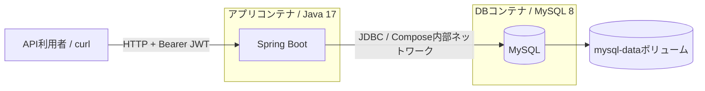
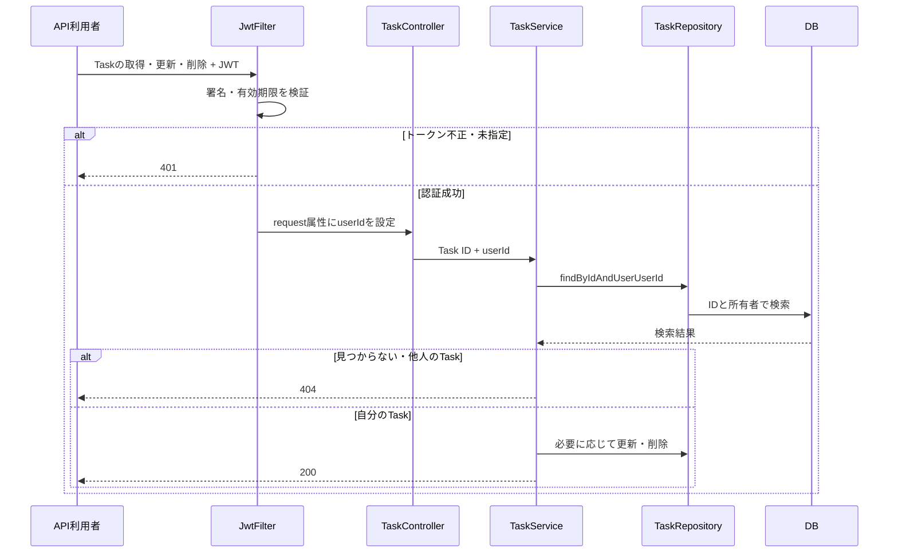

# taskManager

[](https://github.com/shunshiratori/task-manager/actions/workflows/ci.yml)

Spring Boot で構築されたタスク管理アプリケーション。ユーザー認証、プロジェクト管理、タスク管理機能を提供します。

## 概要

このアプリケーションは、以下の機能を持つタスク管理システムです：

- **認証管理**: JWT ベースのトークン認証
- **プロジェクト管理**: ユーザーごとのプロジェクト作成・管理
- **タスク管理**: プロジェクト内のタスク作成・更新・ステータス管理
- **権限制御**: Taskの一覧・取得・更新・削除をログインユーザーに制限

## 技術スタック

- **フレームワーク**: Spring Boot 4.0.3
- **言語**: Java 17
- **データベース**: MySQL
- **認証**: JWT (io.jsonwebtoken)
- **ORM**: Spring Data JPA
- **検証**: Spring Validation
- **ユーティリティ**: Lombok

## 設計意図
### レイヤーアーキテクチャ

アプリケーションは責務を明確に分離した 4 層構造を採用しています：

1. **Controller 層**: HTTP リクエスト/レスポンスの処理
   - REST API エンドポイントの定義
   - リクエストDTOの受け取り
   - JSON シリアライゼーション

2. **Service 層**: ビジネスロジックの実装
   - 複雑な処理フローの実装
   - トランザクション管理
   - データベース操作の調整

3. **Repository 層**: データアクセスの抽象化
   - Spring Data JPA によるデータベース操作
   - クエリの実装
   - エンティティの永続化

4. **Entity 層**: ドメインモデル
   - ビジネスドメインの表現
   - データベーススキーマとのマッピング

### DTO パターン

リクエストとレスポンスに DTO を使用し、以下のメリットを得ています：

- **API との分離**: Entity 構造が変わってもクライアント API は影響を受けない
- **入力の定義**: リクエスト DTO で受け取る項目を定義
- **選択的な情報開示**: パスワードなど機密情報をレスポンスから除外

### JWT 認証

セキュアなステートレス認証を実現：

- `JwtFilter`: `POST /users`・`POST /login`以外のリクエストでJWTを検証
- `JwtUtil`: トークンの生成・検証・パース
- 認証後のリクエストにはユーザー情報がコンテキストに設定される

### トランザクション管理

Service 層で `@Transactional` アノテーションを使用：

- データベース操作を原子性のあるユニットとして実行
- エラー時は自動ロールバック
- 複数リポジトリ操作の一貫性を保証

## API エンドポイント

詳細は [`src/docs/api/`](src/docs/api) ディレクトリを参照：

- [`UsersAPI.md`](src/docs/api/UsersAPI.md) - ユーザー管理 API
- [`ProjectsAPI.md`](src/docs/api/ProjectsAPI.md) - プロジェクト管理 API
- [`TasksAPI.md`](src/docs/api/TasksAPI.md) - タスク管理 API

## ビジネスフロー

### ユーザージャーニー

```
1. ユーザー登録 → 2. ログイン（JWT 取得）
→ 3. プロジェクト一覧を表示
→ 4. プロジェクト詳細を表示
→ 5. 関連タスク一覧を表示
→ 6. タスクを作成・更新
```

### ユースケース

| ユースケース | 説明 |
|---|---|
| ログイン | メールアドレスとパスワードで認証。JWT トークンを取得 |
| プロジェクト一覧 | ユーザーに属するプロジェクト一覧を表示 |
| プロジェクト詳細 | 特定プロジェクトの詳細情報を取得 |
| タスク一覧 | ログインユーザーのタスク一覧を取得 |
| タスク作成 | プロジェクト内に新しいタスクを作成 |
| ステータス変更 | タスクのステータスを更新 |

## セットアップ

### 前提条件

- Java 17
- Docker

### 実行方法

```bash
# 初回のみ: MySQL コンテナを作成・起動
docker run --name mysql-local \
  -e MYSQL_ROOT_PASSWORD=root \
  -e MYSQL_DATABASE=taskmanager \
  -p 3306:3306 \
  -d mysql:8.0
```

2 回目以降は、代わりに停止中のコンテナを起動します。

```bash
docker start mysql-local
```

MySQLの起動完了後、環境変数を準備します。`.env`は自動では読み込まれません。

```bash
cp .env.example .env
openssl rand -hex 32
```

生成した値を`.env`の`JWT_SECRET`に設定します（UTF-8で32バイト以上）。その後、同じシェルで読み込み、起動します。

```bash
set -a
. ./.env
set +a
./mvnw spring-boot:run
```

アプリケーションは`http://localhost:8080`で起動します。ユーザー登録・ログイン以外のAPIには`Authorization: Bearer <token>`が必要です。

デフォルトは`local`プロファイルです。`application-local.yml`のDB接続先は環境変数で変更でき、未指定時は`localhost:3306/taskmanager`、ユーザー名・パスワードは`root`です。`ddl-auto: update`でテーブルを作成・更新し、起動ごとの作り直しを避けます。これは開発用であり、本番のスキーマ移行には使用しません。

本番は`prod`プロファイルを明示し、事前にスキーマを用意します。設定の詳細は[MYSQL_SETUP.md](MYSQL_SETUP.md)を参照してください。

## テスト

現在の起動確認テストはDBとJWT設定を必要とします。ローカルMySQLを使う場合は、上記の環境変数を読み込んだ後に実行します。

```bash
./mvnw test
```

MySQLを使わず、既存のH2依存関係で全テストを確認する場合:

```bash
./mvnw test \
  -Dspring.datasource.url=jdbc:h2:mem:taskmanager-test \
  -Dspring.datasource.driver-class-name=org.h2.Driver \
  -Dspring.jpa.database-platform=org.hibernate.dialect.H2Dialect \
  -Dspring.jpa.hibernate.ddl-auto=create-drop \
  -Djwt.secret=test-only-secret-at-least-32-bytes-long
```

H2での成功はMySQL固有の動作を保証するものではありません。

## CI

[GitHub Actions](.github/workflows/ci.yml)はpush・プルリクエスト・手動実行で、Java 17での既存テストとJAR作成、一時H2環境でのAPI実行例、Dockerイメージのビルドを確認します。公開・デプロイは行いません。H2での確認とは別に、MySQL固有の動作確認は必要です。

## API実行例

[API実行ガイド](src/docs/api/EXAMPLES.md)と[実行スクリプト](scripts/api-example.sh)を用意しています。スクリプトは開発DBにユーザーを作成します。

作成レスポンスのJSONキー`project_id`は`projectId`に統一しています。

## Dockerイメージ

```bash
docker build -t task-manager:local .
```

DockerfileはJava 17でJARを作成し、Java 17の実行環境で非rootユーザーとして起動します。DB接続先とJWT鍵は実行時に渡します。DBの起動完了後、同じDockerネットワークから名前解決できるDBホストを指定してください（コンテナ内の`localhost`はアプリ自身です）。

```bash
docker run --rm --network YOUR_DB_NETWORK -p 8080:8080 \
  --env-file .env -e DB_HOST=YOUR_DB_CONTAINER task-manager:local
```

### Docker ComposeでアプリとMySQLを起動

```bash
cp .env.example .env
openssl rand -hex 32
```

生成した値を`.env`の`JWT_SECRET`に設定します。既に`.env`がある場合はコピーせず、必要な項目を追加してください。Composeは`.env`を自動で読み込みます。

```bash
docker compose up --build -d --wait
BASE_URL=http://localhost:8080 bash scripts/api-example.sh
```

Javaのホストインストールは不要です（API実行例にはBash・curl・Python 3が必要）。アプリは`127.0.0.1:8080`で公開し、MySQLはCompose内部のみで接続します。8080が使用中なら`.env`の`APP_PORT`を変更し、実行例のURLも合わせてください。

MySQLは専用ユーザー`taskapp`で接続し、DB接続確認後にアプリを起動します。アプリのヘルスチェックは未認証の`GET /tasks`が401を返すことを確認します。起動順序は[Compose公式資料](https://docs.docker.com/compose/how-tos/startup-order)の`service_healthy`を使用しています。

```bash
docker compose ps
docker compose logs -f app
docker compose down
```

`down`でも`mysql-data`ボリュームは残るため、再起動後もデータを維持します。**`docker compose down -v`はDBデータを削除します。** DB資格情報を変更しても既存ボリューム内のユーザー情報は自動更新されません。

Composeはローカル開発用です。既存の`mysql-local`コンテナとは別のDBを使用します。`DB_*`はCompose内では固定し、Compose専用の`COMPOSE_DB_PASSWORD`・`COMPOSE_DB_ROOT_PASSWORD`を使います。本番は`prod`設定と事前のスキーマ準備が必要です。

## 構成図



ローカルではアプリをホスト上で直接実行することもできます。CIはDBを一時H2に切り替えます。



## 現在の制限

Taskの所有者制限は一覧・詳細・更新・削除が対象です。Task作成時のuserId指定とProject操作には同等の所有者制限がなく、入力検証・エラーレスポンスの統一も今後の対応事項です。現在のAPI仕様は各API資料を参照してください。
